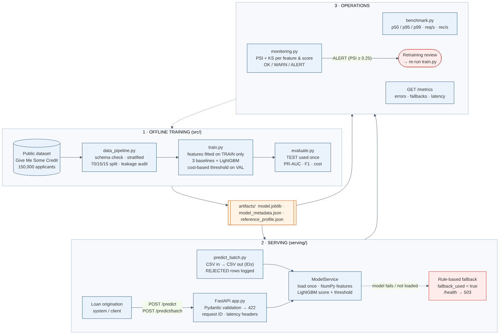

# Mini Production ML System: Credit Default Risk Scoring

End-to-end production ML system that predicts whether a loan applicant will become **90+ days delinquent within two years**. It covers the whole lifecycle: leak-free data split, cost-sensitive LightGBM, serialized pipeline artifacts, a **FastAPI** scoring service with **Pydantic** validation and a graceful fallback, a **batch CLI**, latency/throughput profiling, and **PSI/KS drift monitoring**.

> BITS Pilani WILP · ML Model Engineering · Graded Assignment 1
> Student: **Ayesha Mohammad (2025em1200344)** · GitHub: [ayeshamohammad578](https://github.com/ayeshamohammad578)


---

## Results at a glance

| Model (test set, 22,500 applicants, 6.68% default) | PR-AUC | ROC-AUC | F1-macro | Recall | Cost / 1,000 applicants* |
|---|---|---|---|---|---|
| B0 Prior (no skill) | 0.067 | 0.500 | 0.483 | 0.00 | 334 |
| B1 Heuristic rule (also the serving fallback) | 0.329 | 0.824 | 0.685 | 0.50 | 226 |
| B2 Logistic regression | 0.392 | 0.860 | 0.681 | 0.59 | 218 |
| **LightGBM, threshold tuned (production)** | **0.413** | **0.872** | **0.691** | **0.58** | **212** |
| LightGBM at naive 0.5 threshold | 0.413 | 0.872 | 0.632 | 0.19 | 277 |

\*Expected cost with a missed defaulter = 5 and a wrongly declined good borrower = 1. The cost-chosen threshold (0.16) cuts cost **23%** compared with the default 0.5 cut-off.

| Serving benchmark (2-core CPU) | p50 | p95 | p99 | Throughput |
|---|---|---|---|---|
| `POST /predict`, 1,000 sequential requests | 4.4 ms | 5.8 ms | 7.6 ms | 216 req/s |
| `POST /predict`, 8 concurrent clients (2,000 req) | 35 ms | 52 ms | 60 ms | 222 req/s, 0 errors |
| `POST /predict/batch`, 100 records per call | 7.8 ms | 10.9 ms | 11.8 ms | 12,200 records/s |
| Batch CLI, 22,500-row file | — | — | — | 101,000 records/s (scoring) |

## Architecture



## Quickstart

```bash
git clone https://github.com/ayeshamohammad578/mini-production-ml-system.git && cd mini-production-ml-system
python -m venv .venv && source .venv/bin/activate        # Windows: .venv\Scripts\activate
pip install -r requirements.txt                          # pinned versions

python -m src.data_pipeline     # download + stratified 70/15/15 split + leakage audit
python -m src.train             # baselines + LightGBM -> artifacts/
python -m src.evaluate          # one-time test evaluation -> reports/
python -m pytest -q             # 23 tests (schemas, leakage, inference, API, fallback, batch, drift)
```

`make all` runs the full pipeline. The committed `artifacts/` already contain a trained model, so the API, the batch CLI and the tests work straight after `pip install`.

### Online scoring (REST)

```bash
uvicorn serving.app:app --port 8000          # interactive docs: http://localhost:8000/docs

curl localhost:8000/health
curl -X POST localhost:8000/predict -H "Content-Type: application/json" -d '{
  "applicant_id": "A-10023", "revol_util": 0.45, "age": 41, "late_30_59": 0, "late_60_89": 0,
  "late_90": 0, "debt_ratio": 0.35, "monthly_income": 6200, "open_lines": 8,
  "real_estate_lines": 1, "dependents": 2}'
# {"applicant_id":"A-10023","probability_of_default":0.028813,"decision":"APPROVE","risk_band":"LOW",
#  "threshold":0.16,"model_version":"credit-default-lgbm-1.0.0","fallback_used":false}
```

| Endpoint | Purpose |
|---|---|
| `GET /health` | 200 when the model is loaded; 503 "degraded" when it is running on the fallback |
| `GET /model-info` | version, threshold, features, training metadata |
| `POST /predict` | score one applicant |
| `POST /predict/batch` | score 1 to 1,000 applicants |
| `GET /metrics` | request, error and fallback counts; rolling p50/p95/p99 latency |

Invalid input (missing required field, negative values, age < 18, wrong type, unknown field, malformed JSON) returns **HTTP 422** with field-level details. `monthly_income` and `dependents` may be `null` (they are imputed). Every response carries `X-Request-ID` and `X-Latency-ms` headers.

### Batch scoring

```bash
python -m serving.predict_batch --input data/test.csv --output reports/scored_test.csv --id-col applicant_id
```
Rows that fail validation are not scored. They are written with `status=REJECTED` and a reason, so the job never crashes on bad rows. Throughput is logged.

### Profiling and monitoring

```bash
python -m serving.benchmark                                        # starts its own server; writes reports/benchmark.json
python -m src.monitoring --input data/test.csv                     # healthy: all OK
python -m src.monitoring --input data/test.csv --simulate-drift severe   # stress: ALERT -> retraining review
```

## Key design decisions

* **Leak-free split:** stratified 70/15/15 split *before* any cleaning. Duplicates are removed from train only. All learned preprocessing (outlier caps, medians) lives in `CreditFeatureBuilder` inside the sklearn `Pipeline`, so it is fitted on train only and serialized with the model. The audit is in `reports/leakage_audit.json`.
* **Imbalance (6.7% positives):** compared class-weighted loss with threshold tuning on an unweighted model. Ranking is equal (PR-AUC 0.415 vs 0.414 on validation), but weighting ruins calibration (Brier 0.134 vs 0.049), so production uses the **unweighted model and a cost-optimal threshold chosen on validation**.
* **Metrics:** PR-AUC (ranking quality for the rare class), F1-macro, Recall@Precision ≥ 0.5, Brier score (calibration) and expected business cost. Not accuracy, which would be 93% for a model that approves everyone.
* **Latency:** a NumPy fast path for feature preparation (verified identical to the pandas reference in the tests) plus single-threaded inference for online calls cut p50 latency from 13.0 ms to 4.4 ms and tripled throughput (71 → 216 req/s).
* **Reliability:** if the model fails to load or score, the service falls back to the interpretable heuristic rule, flags `fallback_used=true` and reports `/health` as 503 instead of failing requests.

## Repository layout

```
mini-production-ml-system/
├── README.md, requirements.txt, Makefile, Dockerfile (optional)
├── data/                  # fetched + split by src/data_pipeline.py (CSV not committed)
├── artifacts/             # model.joblib, baseline_logreg.joblib, model_metadata.json, reference_profile.json
├── src/
│   ├── config.py          # paths, schema, costs, drift thresholds
│   ├── data_pipeline.py   # ingestion, validation, stratified split, leakage audit
│   ├── features.py        # CreditFeatureBuilder (rules, train-fitted caps/medians, fast path)
│   ├── train.py           # baselines, LightGBM, imbalance comparison, threshold, export
│   ├── evaluate.py        # one-time test evaluation, PR/cost/calibration plots
│   └── monitoring.py      # PSI + KS drift report, stress scenarios
├── serving/
│   ├── app.py             # FastAPI service
│   ├── schemas.py         # Pydantic input/output contracts
│   ├── model_service.py   # artifact loading, scoring, fallback (shared by API + CLI)
│   ├── predict_batch.py   # batch CLI
│   └── benchmark.py       # latency / throughput / robustness profiling
├── tests/                 # 23 pytest tests
├── reports/               # metrics JSON/CSV, drift reports, figures
└── docs/architecture.*    # architecture diagram (Mermaid source + PNG)
```

## Data and references

* Dataset: *Give Me Some Credit*, Kaggle competition (2011), 150,000 anonymised borrowers. Fetched from a public mirror (URL in `src/config.py`).
* Libraries: scikit-learn, LightGBM, FastAPI, Pydantic, pandas, NumPy, SciPy.
* PSI thresholds (0.10 / 0.25) follow common credit-risk model-monitoring practice.
